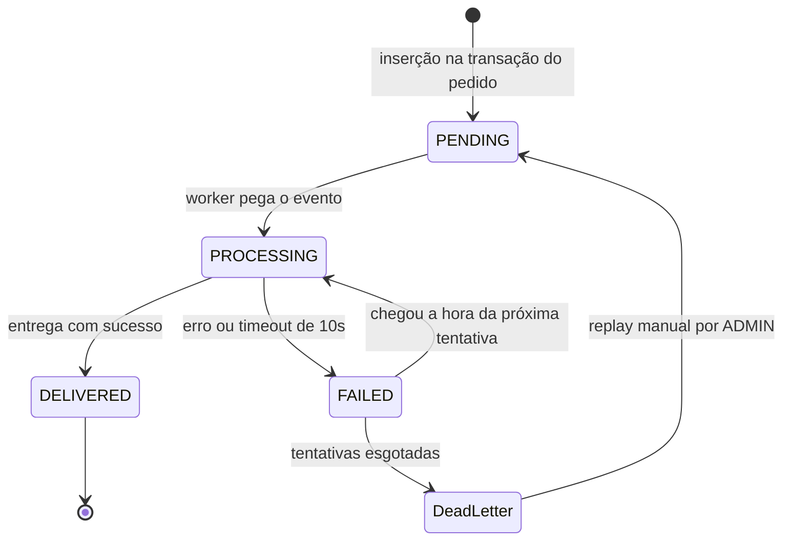
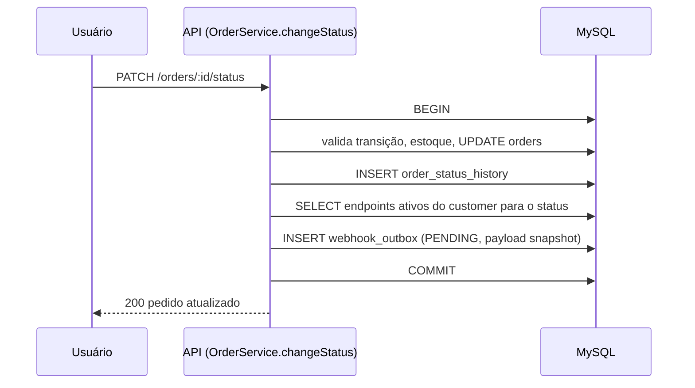
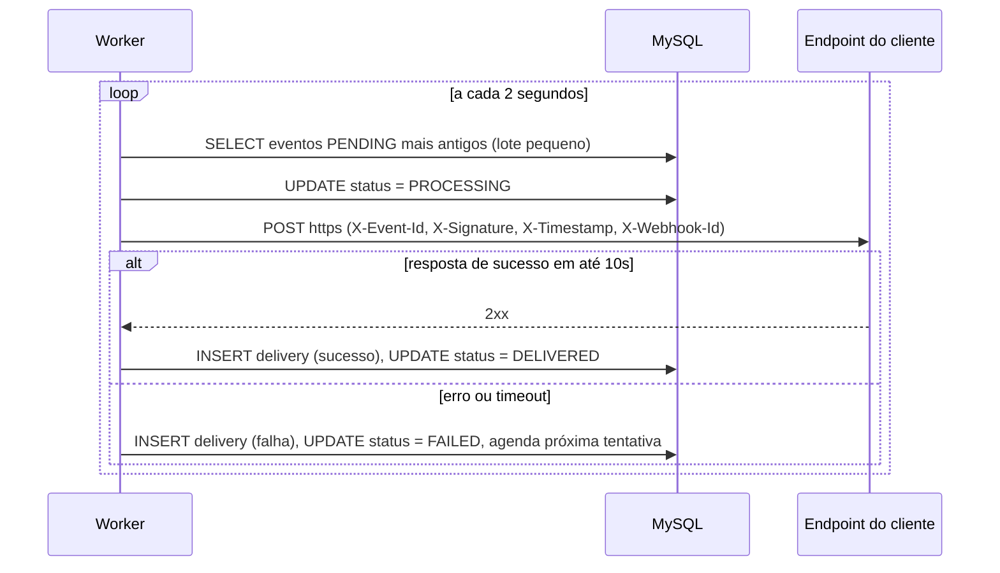

### FDD: Sistema de Webhooks de Notificação de Pedidos

Versão: 0.1 (rascunho para revisão)
Data: 2026-11-17
Responsável: Larissa (Tech Lead), com revisão de Bruno e Diego ([09:50] Larissa)

Documentos relacionados: [PRD](./PRD.md), [RFC](./RFC.md), [ADRs](./adrs/), [Tracker](./TRACKER.md)

> Convenção: tudo o que não tem origem direta na transcrição ou no código está marcado como `[HIPÓTESE]` e listado na seção 3.1 para revisão humana.

---

### 1. Contexto e motivação técnica

O OMS não tem hoje nenhum mecanismo de evento, fila ou webhook. Clientes B2B descobrem mudanças de status consultando `GET /orders` repetidamente ([09:00] Marcos). Este documento especifica como construir a notificação por webhooks de saída decidida na reunião técnica. O porquê de produto está no [PRD](./PRD.md) e o racional de cada decisão está nos [ADRs](./adrs/).

Encaixe na arquitetura atual:

- A mudança de status acontece em `OrderService.changeStatus` (`src/modules/orders/order.service.ts`), dentro de `prisma.$transaction`.
- As transições válidas estão em `src/modules/orders/order.status.ts`: `PENDING → PAID → PROCESSING → SHIPPED → DELIVERED`, com `CANCELLED` a partir dos três primeiros.
- A feature entra como um módulo novo em `src/modules/webhooks`, no mesmo padrão dos módulos existentes ([09:27] Bruno), mais um ponto de entrada novo para o worker ([09:11] Larissa).

Atores:

| Ator | Papel |
|---|---|
| API do OMS | Grava o evento na outbox durante a mudança de status e expõe os endpoints de configuração |
| Worker de webhooks | Processo separado que lê a outbox e faz as entregas HTTP ([09:11] Diego) |
| Endpoint do cliente | Recebe o `POST`, valida a assinatura e deduplica por `X-Event-Id` ([09:25] Diego) |
| Usuário autenticado | Gerencia a configuração de webhooks de um customer pela API ([09:32] Marcos) |
| Usuário `ADMIN` | Faz o replay de eventos da DLQ ([09:36] Sofia) |

Limites: o fluxo é só de saída, do OMS para o cliente ([09:02] Marcos).

---

### 2. Objetivos técnicos

- Entregar a notificação em menos de 10 segundos após a mudança de status, em condição normal ([09:02] Marcos). O polling contribui com até 2 segundos no pior caso ([09:10] Larissa).
- Invariante de atomicidade: não existe mudança de status confirmada sem evento na outbox, nem evento na outbox de uma transação que sofreu rollback ([09:06] Diego, [09:40] Bruno).
- A mudança de status nunca espera nem depende de resposta do cliente ([09:04] Bruno).
- Toda entrega é assinada com HMAC-SHA256 usando a secret do endpoint de destino ([09:22] Sofia).
- Todo evento que esgota as tentativas termina na DLQ, com payload, motivo e timestamp ([09:18] Diego).
- Entrega at-least-once, com `X-Event-Id` estável por evento ([09:26] Larissa).

---

### 3. Escopo e exclusões

**Incluído**
- Gravação do evento na outbox dentro da transação de `changeStatus` ([09:40] Bruno).
- Worker em processo separado, com polling de 2 segundos ([09:10] Larissa).
- Retry com backoff e DLQ em tabela separada, com replay manual ([09:17] Larissa, [09:19] Larissa).
- CRUD de configuração de webhooks por customer, com filtro de status ([09:31] Marcos, [09:33] Bruno).
- Rotação de secret com grace period de 24 horas ([09:21] Sofia).
- Histórico de entregas por endpoint ([09:34] Marcos).
- Assinatura HMAC-SHA256 e headers de entrega ([09:44] Diego, [09:44] Sofia).

**Excluído**
- Disparo síncrono dentro do service de pedidos ([09:06] Diego).
- Redis Streams ou outra infraestrutura de mensageria ([09:07] Diego).
- Trigger de banco para acionar o worker ([09:09] Diego).
- Garantia exactly-once ([09:25] Diego).
- Webhooks de entrada, do cliente para o OMS ([09:02] Marcos).
- Notificação por email quando o webhook do cliente falha. Fica para uma próxima fase ([09:37] Larissa).
- Rate limiting de envio. Observar e decidir depois ([09:39] Larissa).
- Dashboard visual para o cliente. É projeto separado do time de frontend ([09:40] Larissa).
- Vários workers em paralelo e garantia de ordem global ([09:13] Larissa).
- Arquivamento das linhas entregues da outbox ([09:08] Diego).
- Envio dos itens do pedido no payload ([09:43] Diego).
- Endurecimento de permissões no CRUD de configuração ([09:37] Sofia).

#### 3.1 Suposições e pontos a confirmar

Estes pontos não foram ditos na reunião nem existem no código. Foram adotados para o documento ficar acionável e precisam de confirmação.

| ID | Suposição | Motivo |
|---|---|---|
| S-01 | `[HIPÓTESE]` O envio inicial não conta entre as 5 tentativas. São 1 envio mais 5 retentativas, com os intervalos 1m/5m/30m/2h/12h | A soma dos cinco intervalos dá as "quase 15 horas entre primeira falha e última tentativa" ([09:17] Diego). Ver RFC-OQ-05 no [RFC](./RFC.md) |
| S-02 | `[HIPÓTESE]` A outbox tem uma linha por par evento e endpoint de destino | A reunião não disse como tratar um customer com mais de um endpoint interessado no mesmo status. O estado de retry é naturalmente por destino |
| S-03 | `[HIPÓTESE]` Entrega com sucesso é resposta HTTP 2xx dentro do timeout | A reunião só definiu o timeout como falha ([09:42] Diego) |
| S-04 | `[HIPÓTESE]` Rotas `POST /webhooks`, `GET /webhooks`, `PATCH /webhooks/:id`, `DELETE /webhooks/:id` e `POST /webhooks/:id/rotate-secret`, e o nome do campo `statuses` | A reunião definiu os verbos e as rotas de deliveries e replay. As demais rotas seguem o prefixo de `GET /webhooks/:id/deliveries` ([09:34] Marcos) |
| S-05 | `[HIPÓTESE]` Nomes das tabelas `webhook_endpoints` e `webhook_deliveries` | A reunião só nomeou `webhook_outbox` ([09:06] Diego) e `webhook_dead_letter` ([09:18] Diego) |
| S-06 | `[HIPÓTESE]` `X-Signature` leva o HMAC em hexadecimal | O formato de codificação não foi discutido |
| S-07 | Em aberto: qual secret assina o envio durante o grace period, e como o cliente valida com a antiga | A reunião só disse que a antiga "fica válida por 24 horas em paralelo" ([09:21] Sofia) |
| S-08 | `[HIPÓTESE]` O limite de 64KB é verificado na montagem do payload, e o evento que excede vai para a DLQ sem tentativa de envio | A reunião definiu "não envia" e "erra" ([09:23] Sofia, [09:24] Larissa), sem dizer em que ponto |
| S-09 | Em aberto: a situação exata do erro `WEBHOOK_SECRET_REQUIRED` | O código foi citado só como exemplo de nome ([09:28] Bruno) |
| S-10 | `[HIPÓTESE]` O replay mantém o mesmo `event_id` do evento original | Coerente com snapshot e deduplicação, mas não foi dito |
| S-11 | Em aberto: tamanho do lote de leitura do worker | A reunião disse apenas "batch pequeno" ([09:08] Diego) |
| S-12 | Em aberto: destino dos eventos pendentes quando o endpoint é removido ou desativado | Não discutido |
| S-13 | Em aberto: recuperação de eventos que ficaram em `PROCESSING` se o worker cair no meio do envio | Não discutido |

---

### 4. Fluxos detalhados e diagramas

#### 4.1 Modelo de dados lógico

Todas as tabelas novas usam UUID como identificador, como o resto do projeto ([09:51] Larissa). No schema atual isso é `@id @default(uuid()) @db.Char(36)`, com `@@map` para nomes em snake_case (`prisma/schema.prisma`).

| Tabela | Conteúdo | Origem |
|---|---|---|
| Configuração de webhook (`webhook_endpoints`, S-05) | url, secret, customer_id, estado ativo, lista de status de interesse, e os dados da secret anterior durante o grace period | [09:21] Bruno, [09:31] Marcos, [09:21] Sofia |
| `webhook_outbox` | event_id (UUID), payload já renderizado, status do evento, `created_at`, e o controle de tentativas. Índices em status e em `created_at` | [09:06] Diego, [09:08] Diego, [09:52] Larissa |
| Histórico de entregas (`webhook_deliveries`, S-05) | uma linha por tentativa: sucesso ou falha, payload, response e tempo de resposta | [09:34] Marcos |
| `webhook_dead_letter` | payload, motivo da falha e timestamp | [09:18] Diego |

Status do evento na outbox: `PENDING`, `PROCESSING`, `FAILED` e `DELIVERED` (pendente, processando, falhou, entregue) ([09:08] Diego).



#### FDD-FLUXO-01 Criação do evento na outbox

1. Um usuário chama `PATCH /api/v1/orders/:id/status`. O controller chama `OrderService.changeStatus`.
2. Dentro de `prisma.$transaction`, o service valida a transição, movimenta estoque, atualiza o pedido e grava `OrderStatusHistory` (comportamento atual).
3. Ainda na mesma transação, o service chama `publishWebhookEvent(tx, order, fromStatus, toStatus)`, passando o client da transação ([09:41] Bruno).
4. A função busca os endpoints ativos do customer do pedido que escolheram receber o status de destino. O filtro acontece aqui, na inserção ([09:33] Marcos, [09:34] Bruno).
5. Se nenhum endpoint do customer quer aquele status, nada é inserido ([09:34] Bruno).
6. Para cada endpoint interessado, a função gera um UUID de evento ([09:25] Diego), monta o payload como snapshot ([09:52] Larissa) e insere a linha na `webhook_outbox` com status `PENDING` (S-02).
7. Se a inserção falhar, a exceção sobe e a transação inteira sofre rollback, incluindo a mudança de status ([09:40] Bruno).



Observação: a criação do pedido grava o primeiro histórico (`null → PENDING`) em `OrderService.create`, fora de `changeStatus`. A reunião só tratou a integração em `changeStatus` ([09:40] Bruno), então a criação do pedido não gera evento.

#### FDD-FLUXO-02 Processamento pelo worker

1. O worker roda como processo separado, com ponto de entrada próprio e instância própria de `PrismaClient` ([09:11] Diego, [09:30] Bruno).
2. A cada 2 segundos, busca os eventos pendentes mais antigos, em lote pequeno, por ordem de `created_at` ([09:09] Diego, [09:08] Diego).
3. Para cada evento, marca como `PROCESSING` e monta a requisição: corpo igual ao payload gravado, mais os headers do FDD-CONTRATO-08.
4. Calcula o HMAC-SHA256 do corpo com a secret do endpoint ([09:22] Sofia).
5. Envia o `POST` para a URL do endpoint, com timeout de 10 segundos ([09:42] Diego).
6. Registra a tentativa no histórico de entregas, com resultado, response e tempo de resposta ([09:34] Marcos).
7. Em caso de sucesso (S-03), marca o evento como `DELIVERED` ([09:08] Diego). Em caso de falha, segue o FDD-FLUXO-03.



Ordem: com um único worker lendo por `created_at`, os eventos de um mesmo pedido saem em ordem. Não há garantia de ordem global ([09:12] Diego, [09:13] Larissa).

#### FDD-FLUXO-03 Retry com backoff

1. Falha é qualquer erro de envio ou ausência de resposta em 10 segundos ([09:42] Diego).
2. A cada falha, o evento é marcado como `FAILED` e a próxima tentativa é agendada conforme a tabela abaixo ([09:17] Larissa).
3. O worker só pega de novo o evento quando o horário agendado chega.

| Falha número | Espera até a próxima tentativa |
|---|---|
| 1 | 1 minuto |
| 2 | 5 minutos |
| 3 | 30 minutos |
| 4 | 2 horas |
| 5 | 12 horas |

Total: quase 15 horas entre a primeira falha e a última tentativa ([09:17] Diego). A contagem segue a suposição S-01.

#### FDD-FLUXO-04 DLQ e replay

1. Quando a última tentativa falha, o evento é considerado falha permanente ([09:15] Diego).
2. O worker grava uma linha em `webhook_dead_letter` com o payload, o motivo da falha e o timestamp, e o evento sai do processamento normal da outbox ([09:18] Diego).
3. Um usuário com role `ADMIN` chama `POST /api/v1/admin/webhooks/dead-letter/:id/replay` (FDD-CONTRATO-07).
4. O evento volta para a outbox como `PENDING` ([09:18] Diego) e segue o FDD-FLUXO-02.
5. O replay gera log com quem executou, para auditoria ([09:36] Sofia).

#### FDD-FLUXO-05 Rotação de secret

1. O usuário pede uma nova secret pela API (FDD-CONTRATO-05) ([09:21] Sofia).
2. O OMS gera a nova secret e a devolve na resposta.
3. A secret antiga continua válida por 24 horas em paralelo. Depois disso, deixa de valer ([09:21] Sofia).
4. O comportamento de assinatura durante as 24 horas está em aberto (S-07).

**Fluxos alternativos e exceções**
- Nenhum endpoint do customer quer o status: nada é inserido na outbox ([09:34] Bruno).
- Payload acima de 64KB: o evento não é enviado e gera erro ([09:24] Larissa). Ver S-08 e FDD-ERR-04.
- Cliente responde depois de 10 segundos: conta como falha, mesmo que ele tenha processado. A nova tentativa pode gerar duplicata, que o cliente resolve pelo `X-Event-Id` ([09:24] Diego, [09:25] Diego).
- Endpoint removido ou desativado com eventos pendentes: não discutido (S-12).

---

### 5. Contratos públicos (endpoints, headers, exemplos)

Regras comuns, vindas do código atual:

- Prefixo `/api/v1`, onde `src/app.ts` monta o router de `src/routes/index.ts`.
- Autenticação por `Authorization: Bearer <JWT>` com o middleware `authenticate` de `src/middlewares/auth.middleware.ts`. O JWT é de usuário do OMS, e o `customer_id` não vem do token: vai no body ou na rota ([09:32] Larissa).
- Qualquer role autenticada acessa o CRUD de configuração ([09:36] Marcos, [09:37] Sofia). Só o replay exige `ADMIN` ([09:36] Larissa).
- Validação com Zod pelo middleware `validate` de `src/middlewares/validate.middleware.ts`.
- Erros no formato `{ "error": { "code", "message", "details?" } }`, produzido por `src/middlewares/error.middleware.ts`.
- Corpo de request e response em camelCase, como em `src/modules/orders/order.schemas.ts`. O payload enviado ao cliente usa snake_case, como definido na reunião ([09:43] Diego).
- A secret só aparece na resposta da criação e da rotação. Nenhum outro endpoint a devolve `[HIPÓTESE]`.

**FDD-CONTRATO-01 Cadastrar webhook**
- Tipo: endpoint
- Rota: `POST /api/v1/webhooks` (S-04)
- Método: POST
- Autenticação: `authenticate`, qualquer role
- Origem: [09:31] Marcos, [09:32] Larissa
- Semântica de status/headers:
  - `201`: endpoint criado. A resposta traz a secret gerada pelo OMS ([09:31] Marcos).
  - `400 WEBHOOK_INVALID_URL`: URL não é `https` ([09:23] Sofia).
  - `400 VALIDATION_ERROR`: body inválido.
  - `401 UNAUTHORIZED`: token ausente ou inválido.
  - `404 NOT_FOUND`: customer inexistente, como já faz `OrderService.create`.

Exemplo de requisição
```json
{
  "customerId": "5f0c2a9e-3b7d-4e61-9a55-2d8f1c7b6a10",
  "url": "https://integracao.cliente.example/webhooks/pedidos",
  "statuses": ["SHIPPED", "DELIVERED"]
}
```

Exemplo de resposta (`201`)
```json
{
  "id": "b3a1f6c2-7d54-4c0e-8f21-9e6d5a4b3c2d",
  "customerId": "5f0c2a9e-3b7d-4e61-9a55-2d8f1c7b6a10",
  "url": "https://integracao.cliente.example/webhooks/pedidos",
  "statuses": ["SHIPPED", "DELIVERED"],
  "active": true,
  "secret": "<secret gerada, exibida nesta resposta>",
  "createdAt": "2026-11-17T12:00:00.000Z",
  "updatedAt": "2026-11-17T12:00:00.000Z"
}
```

**FDD-CONTRATO-02 Listar webhooks de um customer**
- Tipo: endpoint
- Rota: `GET /api/v1/webhooks?customerId=<uuid>` (S-04)
- Método: GET
- Autenticação: `authenticate`, qualquer role
- Origem: [09:33] Bruno
- Semântica de status/headers:
  - `200`: lista no envelope `{ data, pagination }` de `src/shared/http/response.ts`. Não inclui a secret.
  - `400 VALIDATION_ERROR`: `customerId` ausente ou inválido.
  - `401 UNAUTHORIZED`.

Exemplo de requisição
```http
GET /api/v1/webhooks?customerId=5f0c2a9e-3b7d-4e61-9a55-2d8f1c7b6a10&page=1&pageSize=20
Authorization: Bearer <JWT>
```

Exemplo de resposta (`200`)
```json
{
  "data": [
    {
      "id": "b3a1f6c2-7d54-4c0e-8f21-9e6d5a4b3c2d",
      "customerId": "5f0c2a9e-3b7d-4e61-9a55-2d8f1c7b6a10",
      "url": "https://integracao.cliente.example/webhooks/pedidos",
      "statuses": ["SHIPPED", "DELIVERED"],
      "active": true,
      "createdAt": "2026-11-17T12:00:00.000Z",
      "updatedAt": "2026-11-17T12:00:00.000Z"
    }
  ],
  "pagination": { "page": 1, "pageSize": 20, "total": 1, "totalPages": 1 }
}
```

**FDD-CONTRATO-03 Editar webhook**
- Tipo: endpoint
- Rota: `PATCH /api/v1/webhooks/:id` (S-04)
- Método: PATCH
- Autenticação: `authenticate`, qualquer role
- Origem: [09:33] Bruno
- Semântica de status/headers:
  - `200`: endpoint atualizado. Campos editáveis: `url`, `statuses` e `active`. Não inclui a secret.
  - `400 WEBHOOK_INVALID_URL`: nova URL não é `https`.
  - `400 VALIDATION_ERROR`.
  - `401 UNAUTHORIZED`.
  - `404 WEBHOOK_NOT_FOUND`.

Exemplo de requisição
```json
{
  "statuses": ["PAID", "SHIPPED", "DELIVERED", "CANCELLED"],
  "active": true
}
```

Exemplo de resposta (`200`)
```json
{
  "id": "b3a1f6c2-7d54-4c0e-8f21-9e6d5a4b3c2d",
  "customerId": "5f0c2a9e-3b7d-4e61-9a55-2d8f1c7b6a10",
  "url": "https://integracao.cliente.example/webhooks/pedidos",
  "statuses": ["PAID", "SHIPPED", "DELIVERED", "CANCELLED"],
  "active": true,
  "createdAt": "2026-11-17T12:00:00.000Z",
  "updatedAt": "2026-11-17T12:30:00.000Z"
}
```

**FDD-CONTRATO-04 Remover webhook**
- Tipo: endpoint
- Rota: `DELETE /api/v1/webhooks/:id` (S-04)
- Método: DELETE
- Autenticação: `authenticate`, qualquer role
- Origem: [09:33] Bruno
- Semântica de status/headers:
  - `204`: removido, sem corpo, como em `OrderController.delete`.
  - `401 UNAUTHORIZED`.
  - `404 WEBHOOK_NOT_FOUND`.

Exemplo de requisição
```http
DELETE /api/v1/webhooks/b3a1f6c2-7d54-4c0e-8f21-9e6d5a4b3c2d
Authorization: Bearer <JWT>
```

Exemplo de resposta (`404`)
```json
{
  "error": { "code": "WEBHOOK_NOT_FOUND", "message": "Webhook not found" }
}
```

**FDD-CONTRATO-05 Rotacionar secret**
- Tipo: endpoint
- Rota: `POST /api/v1/webhooks/:id/rotate-secret` (S-04)
- Método: POST
- Autenticação: `authenticate`, qualquer role
- Origem: [09:21] Sofia
- Semântica de status/headers:
  - `200`: nova secret gerada e devolvida. A antiga vale por mais 24 horas ([09:21] Sofia).
  - `401 UNAUTHORIZED`.
  - `404 WEBHOOK_NOT_FOUND`.

Exemplo de requisição
```http
POST /api/v1/webhooks/b3a1f6c2-7d54-4c0e-8f21-9e6d5a4b3c2d/rotate-secret
Authorization: Bearer <JWT>
```

Exemplo de resposta (`200`)
```json
{
  "id": "b3a1f6c2-7d54-4c0e-8f21-9e6d5a4b3c2d",
  "secret": "<nova secret, exibida nesta resposta>",
  "previousSecretExpiresAt": "2026-11-18T12:00:00.000Z"
}
```

**FDD-CONTRATO-06 Histórico de entregas**
- Tipo: endpoint
- Rota: `GET /api/v1/webhooks/:id/deliveries` ([09:34] Marcos)
- Método: GET
- Autenticação: `authenticate`, qualquer role
- Origem: [09:34] Marcos
- Semântica de status/headers:
  - `200`: entregas mais recentes do endpoint, até 100 ([09:34] Marcos), no envelope `{ data, pagination }`. O teto de 100 por página é o mesmo de `listOrdersQuerySchema`.
  - `401 UNAUTHORIZED`.
  - `404 WEBHOOK_NOT_FOUND`.
- Campos de cada entrega: resultado (sucesso ou falha), payload, response e tempo de resposta ([09:34] Marcos).

Exemplo de requisição
```http
GET /api/v1/webhooks/b3a1f6c2-7d54-4c0e-8f21-9e6d5a4b3c2d/deliveries?page=1&pageSize=100
Authorization: Bearer <JWT>
```

Exemplo de resposta (`200`)
```json
{
  "data": [
    {
      "id": "0d9e8c7b-6a5f-4e3d-9c2b-1a0f9e8d7c6b",
      "eventId": "7c1d2e3f-4a5b-4c6d-8e7f-9a0b1c2d3e4f",
      "success": true,
      "payload": { "event_id": "7c1d2e3f-4a5b-4c6d-8e7f-9a0b1c2d3e4f", "event_type": "order.status_changed" },
      "response": { "status": 200, "body": "ok" },
      "responseTimeMs": 182,
      "createdAt": "2026-11-17T12:00:03.000Z"
    }
  ],
  "pagination": { "page": 1, "pageSize": 100, "total": 1, "totalPages": 1 }
}
```

**FDD-CONTRATO-07 Replay de evento da DLQ**
- Tipo: endpoint
- Rota: `POST /api/v1/admin/webhooks/dead-letter/:id/replay` ([09:35] Diego)
- Método: POST
- Autenticação: `authenticate` mais `requireRole('ADMIN')` ([09:36] Larissa)
- Origem: [09:18] Diego, [09:36] Sofia
- Semântica de status/headers:
  - `200`: evento recolocado na outbox como pendente ([09:18] Diego).
  - `401 UNAUTHORIZED`.
  - `403 FORBIDDEN`: usuário sem role `ADMIN`, resposta padrão do `requireRole`.
  - `404 WEBHOOK_DEAD_LETTER_NOT_FOUND`.
- Efeito colateral obrigatório: log de auditoria com o usuário que fez o replay ([09:36] Sofia).

Exemplo de requisição
```http
POST /api/v1/admin/webhooks/dead-letter/4e5f6a7b-8c9d-4e0f-a1b2-c3d4e5f6a7b8/replay
Authorization: Bearer <JWT de usuário ADMIN>
```

Exemplo de resposta (`200`)
```json
{
  "deadLetterId": "4e5f6a7b-8c9d-4e0f-a1b2-c3d4e5f6a7b8",
  "eventId": "7c1d2e3f-4a5b-4c6d-8e7f-9a0b1c2d3e4f",
  "status": "PENDING"
}
```

**FDD-CONTRATO-08 Entrega do webhook ao cliente (saída)**
- Tipo: requisição HTTP de saída
- Rota: URL `https` cadastrada pelo cliente ([09:23] Sofia)
- Método: POST
- Autenticação: assinatura HMAC-SHA256 do corpo com a secret do endpoint ([09:22] Sofia)
- Timeout: 10 segundos ([09:42] Diego)
- Tamanho máximo do payload: 64KB ([09:24] Larissa)

| Header | Significado | Origem |
|---|---|---|
| `Content-Type` | `application/json` | [09:44] Diego |
| `X-Event-Id` | UUID do evento, gerado na entrada da outbox. Igual em todas as tentativas. Chave de deduplicação do cliente | [09:25] Diego |
| `X-Signature` | HMAC-SHA256 do corpo do request (S-06) | [09:20] Sofia, [09:44] Diego |
| `X-Timestamp` | Momento do envio. Permite ao cliente detectar replay attack, se quiser | [09:44] Diego |
| `X-Webhook-Id` | Id do endpoint cadastrado, para o cliente com vários cadastros saber qual recebeu | [09:44] Sofia |

| Campo do payload | Significado |
|---|---|
| `event_id` | Mesmo valor de `X-Event-Id` |
| `event_type` | `order.status_changed` |
| `timestamp` | Data e hora em ISO 8601 |
| `order_id`, `order_number` | Identificação do pedido |
| `from_status`, `to_status` | Status de origem e de destino |
| `customer_id` | Customer dono do pedido |
| `total_cents` | Campo básico do pedido |

Todos os campos vêm de [09:43] Diego. O payload não leva os itens do pedido. Quem precisar de detalhes consulta `GET /orders/:id` ([09:43] Diego).

Exemplo de requisição
```http
POST /webhooks/pedidos HTTP/1.1
Host: integracao.cliente.example
Content-Type: application/json
X-Event-Id: 7c1d2e3f-4a5b-4c6d-8e7f-9a0b1c2d3e4f
X-Signature: <hmac-sha256 do corpo>
X-Timestamp: 2026-11-17T12:00:03.000Z
X-Webhook-Id: b3a1f6c2-7d54-4c0e-8f21-9e6d5a4b3c2d
```
```json
{
  "event_id": "7c1d2e3f-4a5b-4c6d-8e7f-9a0b1c2d3e4f",
  "event_type": "order.status_changed",
  "timestamp": "2026-11-17T12:00:01.000Z",
  "order_id": "9a8b7c6d-5e4f-4a3b-8c2d-1e0f9a8b7c6d",
  "order_number": "ORD-000042",
  "from_status": "PROCESSING",
  "to_status": "SHIPPED",
  "customer_id": "5f0c2a9e-3b7d-4e61-9a55-2d8f1c7b6a10",
  "total_cents": 15990
}
```

Exemplo de resposta esperada do cliente
```http
HTTP/1.1 200 OK
```

---

### 6. Erros, exceções e fallback

#### 6.1 Matriz de erros

Todos os códigos do módulo usam o prefixo `WEBHOOK_` ([09:29] Larissa). Os três primeiros nomes foram citados na reunião ([09:28] Bruno). Os demais são nomes propostos no mesmo padrão.

| ID | Código | HTTP | Situação | Tratamento | Classe base reutilizada |
|---|---|---|---|---|---|
| FDD-ERR-01 | `WEBHOOK_NOT_FOUND` | 404 | Endpoint de webhook não existe para o id informado | Resposta de erro padrão | `AppError` direto, pois `NotFoundError` fixa o código `NOT_FOUND` (`src/shared/errors/http-errors.ts`) |
| FDD-ERR-02 | `WEBHOOK_INVALID_URL` | 400 | URL cadastrada ou editada não é `https` ([09:23] Sofia) | Cadastro recusado | `BadRequestError`, que aceita código próprio |
| FDD-ERR-03 | `WEBHOOK_SECRET_REQUIRED` | a definir | Situação em aberto (S-09) | A definir | A definir |
| FDD-ERR-04 | `WEBHOOK_PAYLOAD_TOO_LARGE` (nome proposto) | sem resposta HTTP, erro interno | Payload do evento passa de 64KB ([09:24] Larissa) | Evento não é enviado. Erro registrado em log e na DLQ (S-08) | `AppError` |
| FDD-ERR-05 | `WEBHOOK_DEAD_LETTER_NOT_FOUND` (nome proposto) | 404 | Id de DLQ informado no replay não existe | Resposta de erro padrão | `AppError` direto, pelo mesmo motivo do FDD-ERR-01 |
| FDD-ERR-06 | `WEBHOOK_DELIVERY_TIMEOUT` (nome proposto) | sem resposta HTTP, motivo de falha | Cliente não respondeu em 10 segundos ([09:42] Diego) | Tentativa registrada como falha. Segue FDD-FLUXO-03 | Valor gravado como motivo no histórico e na DLQ |
| FDD-ERR-07 | `WEBHOOK_DELIVERY_FAILED` (nome proposto) | sem resposta HTTP, motivo de falha | Erro de conexão ou resposta que não é sucesso (S-03) | Tentativa registrada como falha. Segue FDD-FLUXO-03 | Valor gravado como motivo no histórico e na DLQ |

Erros genéricos já existentes que os endpoints do módulo também devolvem, sem código novo:

| Código | HTTP | Situação | Origem no código |
|---|---|---|---|
| `VALIDATION_ERROR` | 400 | Body, query ou params inválidos | `src/middlewares/validate.middleware.ts` |
| `UNAUTHORIZED` | 401 | Token ausente, inválido ou expirado | `src/middlewares/auth.middleware.ts` |
| `FORBIDDEN` | 403 | Replay por usuário sem role `ADMIN` | `src/middlewares/auth.middleware.ts` |

Ponto de atenção: a reunião tratou a exigência de `https` como "só uma validação no schema Zod" ([09:23] Sofia). Uma falha de schema Zod sai hoje como `VALIDATION_ERROR`, não como `WEBHOOK_INVALID_URL`. Para devolver o código `WEBHOOK_INVALID_URL` pedido por Bruno ([09:28] Bruno), a checagem de `https` precisa lançar o erro do módulo explicitamente. A escolha entre os dois comportamentos precisa de confirmação.

#### 6.2 Estratégias de resiliência

- **FDD-RES-01 Timeout:** 10 segundos por chamada. Sem resposta nesse tempo, a tentativa é falha ([09:42] Diego).
- **FDD-RES-02 Retries e backoff:** 5 tentativas com intervalos de 1m, 5m, 30m, 2h e 12h ([09:17] Larissa).
- **FDD-RES-03 DLQ:** eventos com tentativas esgotadas vão para `webhook_dead_letter` e podem ser reprocessados manualmente ([09:18] Diego).
- **FDD-RES-04 Isolamento de processo:** o worker roda fora da API. Reinício da API não interrompe entregas ([09:11] Diego).
- **FDD-RES-05 Isolamento da transação do pedido:** nenhuma chamada HTTP acontece dentro de `changeStatus`. Cliente lento ou fora do ar não afeta a mudança de status ([09:04] Bruno).
- **FDD-RES-06 Limite de payload:** 64KB. Acima disso o evento gera erro em vez de ser truncado ([09:23] Sofia, [09:24] Diego).
- **Fallback:** não há canal alternativo de notificação nesta fase. Email ficou para a próxima ([09:37] Larissa).

Parâmetros e valores default:

| Parâmetro | Default | Origem |
|---|---|---|
| Intervalo de polling | 2 segundos | [09:09] Diego |
| Timeout da chamada HTTP | 10 segundos | [09:42] Diego |
| Número de tentativas | 5 | [09:17] Larissa |
| Intervalos de backoff | 1m, 5m, 30m, 2h, 12h | [09:17] Diego |
| Tamanho máximo do payload | 64KB | [09:24] Diego |
| Grace period da secret antiga | 24 horas | [09:21] Sofia |
| Tamanho do lote do worker | a definir (S-11) | [09:08] Diego |

A reunião fixou os valores, mas não disse se devem ser configuráveis. Se forem, o caminho natural é o schema Zod de `src/config/env.ts` `[HIPÓTESE]`.

#### 6.3 Invariantes

- Se a transação de mudança de status foi confirmada e há endpoint interessado, o evento existe na outbox ([09:06] Diego).
- Se a transação sofreu rollback, nenhum evento dela existe na outbox ([09:06] Diego).
- Um mesmo `X-Event-Id` pode ser entregue mais de uma vez, e nunca identifica dois eventos diferentes ([09:25] Diego).
- O payload enviado é o gravado na inserção. Ele não é recalculado em retry nem em replay ([09:52] Larissa).
- Nenhuma requisição sai para URL que não seja `https` ([09:23] Sofia).
- Nenhuma requisição sai sem `X-Signature` ([09:22] Sofia).
- A ordem dos eventos de um mesmo pedido é preservada enquanto houver um único worker ([09:13] Larissa).

---

### 7. Observabilidade

A reunião não definiu nomes de métricas nem de spans. Os itens abaixo são propostas `[HIPÓTESE]` derivadas do que a reunião pediu para medir ou observar. Os logs seguem o padrão já existente.

Métricas
- **FDD-OBS-01** `webhook_deliveries_total{result}`: entregas por resultado, sucesso ou falha. Base do histórico pedido em [09:34] Marcos.
- **FDD-OBS-02** `webhook_delivery_duration_ms`: tempo de resposta do cliente ([09:34] Marcos), com atenção ao teto de 10 segundos ([09:42] Diego).
- **FDD-OBS-03** `webhook_event_latency_ms`: tempo entre a inserção na outbox e a entrega com sucesso. Valida a meta de menos de 10 segundos ([09:02] Marcos).
- **FDD-OBS-04** `webhook_outbox_pending`: eventos pendentes na outbox. Responde à preocupação com acúmulo ([09:07] Bruno).
- **FDD-OBS-05** `webhook_dead_letter_total`: eventos movidos para a DLQ ([09:18] Diego).
- **FDD-OBS-06** `webhook_events_enqueued_total{webhook_id}`: volume de eventos por endpoint. Dá o dado para a decisão futura sobre rate limiting ([09:39] Diego).

O projeto não tem biblioteca de métricas em `package.json`. O mecanismo de exposição precisa ser definido.

Logs
- **FDD-OBS-07** Logs estruturados com o Pino de `src/shared/logger/index.ts`, sem biblioteca nova ([09:29] Bruno). Mensagens em snake_case, como `server_started` e `http_request` no código atual.
- Campos essenciais nos logs do worker: `eventId`, `webhookId`, `orderId`, `customerId`, `attempt`, `result`, `responseStatus`, `durationMs`.
- **FDD-OBS-08** Log de auditoria do replay, com `userId` de quem executou e o id da DLQ ([09:36] Sofia).
- Proteção de dados: a secret nunca vai para log. A lista `redactPaths` do logger hoje cobre `authorization`, `password`, `passwordHash`, `token` e `accessToken`, mas não cobre `secret`. É preciso acrescentar. A preocupação tem base em um vazamento de secret em log já ocorrido do lado de um cliente ([09:22] Diego).
- O logger atual fixa `service: 'order-management-api'` no campo base. Os logs do worker precisam de um campo que os diferencie `[HIPÓTESE]`.

Tracing
- **FDD-OBS-09** O projeto não tem biblioteca de tracing. A correlação existente é o `X-Request-Id`, criado ou propagado em `src/middlewares/request-logger.middleware.ts`.
- Proposta `[HIPÓTESE]`: gravar no log da inserção na outbox o `requestId` da requisição que mudou o status junto com o `eventId`. A partir daí, `eventId` correlaciona todas as tentativas, a DLQ e o replay.
- Spans lógicos, caso uma biblioteca de tracing seja adotada `[HIPÓTESE]`: `webhook.outbox.enqueue` (atributos `order.id`, `event.id`), `webhook.worker.poll` (atributo `batch.size`), `webhook.delivery.attempt` (atributos `event.id`, `webhook.id`, `attempt`, `http.status_code`), `webhook.dead_letter.move` e `webhook.dead_letter.replay` (atributo `user.id`).

Dashboards e alertas
- Proposta `[HIPÓTESE]`: alerta para crescimento da DLQ, para eventos pendentes acumulando na outbox e para latência de entrega acima de 10 segundos.

---

### 8. Dependências e compatibilidade

| Versão mínima | Componente | Observações |
|---|---|---|
| Node.js >= 20 | Runtime | Definido em `engines` do `package.json`. API e worker usam a mesma stack ([09:11] Diego) |
| MySQL 8.0 | Banco | Imagem `mysql:8.0` em `docker-compose.yml`. Sem NOTIFY/LISTEN, o que motivou o polling ([09:09] Diego) |
| Prisma 5.22.0 | ORM e migrations | Novas tabelas entram em `prisma/schema.prisma`. O worker usa instância própria de `PrismaClient` ([09:30] Bruno) |
| Express 4.21.1 | HTTP da API | Endpoints novos seguem o padrão de router atual |
| Zod 3.23.8 | Validação | Schemas do módulo e validação de `https` ([09:23] Sofia) |
| Pino 9.5.0 | Logs | Reuso sem biblioteca nova ([09:29] Bruno) |
| uuid 11.0.3 | Geração de UUID | Já usado em `src/middlewares/request-logger.middleware.ts`. Serve para o `event_id` |
| jsonwebtoken 9.0.2 | Autenticação | JWT atual dos usuários do OMS ([09:32] Marcos) |

Dependências entre pessoas e times:
- Revisão de segurança de pelo menos dois dias úteis antes do deploy, com foco em HMAC e geração de secret ([09:46] Sofia).
- Documentação de integração no portal de desenvolvedor, a cargo do PM ([09:26] Marcos, [09:40] Marcos).

Garantias de compatibilidade
- Nenhum endpoint existente muda de contrato. `PATCH /api/v1/orders/:id/status` mantém request e response.
- A mudança em `changeStatus` é aditiva: uma escrita a mais na mesma transação ([09:40] Bruno).
- Clientes sem webhook cadastrado não geram linha na outbox ([09:34] Bruno).
- O worker precisa das mesmas variáveis de ambiente validadas em `src/config/env.ts`. Esse schema hoje exige `JWT_SECRET`, que o worker não usa. Ou o worker recebe a variável mesmo assim, ou o schema é separado por processo `[HIPÓTESE]`.

---

### 9. Integração com o sistema existente

Cada linha indica o que existe hoje e o que muda. Arquivos novos estão listados depois da tabela.

| ID | Arquivo | Situação atual | Integração proposta |
|---|---|---|---|
| FDD-INT-01 | `src/modules/orders/order.service.ts` | `OrderService.changeStatus` roda em `prisma.$transaction`: valida a transição, movimenta estoque, atualiza o pedido e grava `orderStatusHistory`. O tipo `TxClient` já existe no arquivo | Depois de gravar o histórico e antes do fim da transação, chamar `publishWebhookEvent(tx, order, from, to)` ([09:41] Bruno). Falha na inserção causa rollback ([09:40] Bruno) |
| FDD-INT-02 | `src/modules/orders/order.status.ts` | Define as transições válidas e as funções `canTransition`, `shouldDebitStock` e `shouldReplenishStock` | Sem alteração. Toda transição aceita por `canTransition` é candidata a evento. O filtro é a lista de status de cada endpoint ([09:33] Marcos) |
| FDD-INT-03 | `prisma/schema.prisma` | Models com `id` UUID em `Char(36)`, `@@map` em snake_case e enum `OrderStatus` | Novos models para configuração de webhook, outbox, entregas e DLQ, com UUID ([09:51] Larissa) e índices em status e `created_at` na outbox ([09:08] Diego). Nova migration em `prisma/migrations` |
| FDD-INT-04 | `src/shared/errors/app-error.ts` | `AppError(message, statusCode, errorCode, details)` | Base das classes de erro do módulo com códigos `WEBHOOK_*` ([09:28] Bruno) |
| FDD-INT-05 | `src/shared/errors/http-errors.ts` | Subclasses como `ConflictError` e `BadRequestError` aceitam código próprio. `NotFoundError` e `ValidationError` têm código fixo | Reuso das classes que aceitam código. Erros 404 do módulo estendem `AppError` direto |
| FDD-INT-06 | `src/middlewares/error.middleware.ts` | Converte `AppError`, `ZodError` e erros Prisma `P2002` e `P2025` no formato `{ error: { code, message, details? } }` | Sem alteração. Os erros `WEBHOOK_*` são tratados como qualquer `AppError` ([09:29] Bruno) |
| FDD-INT-07 | `src/middlewares/auth.middleware.ts` | Exporta `authenticate` e `requireRole(...roles)`, com roles `ADMIN` e `OPERATOR` | `authenticate` em todas as rotas do módulo. `requireRole('ADMIN')` na rota de replay ([09:36] Larissa) |
| FDD-INT-08 | `src/middlewares/validate.middleware.ts` | `validate({ body, query, params })` com schemas Zod | Reuso com os schemas de `webhook.schemas.ts`, incluindo a exigência de `https` ([09:23] Sofia) |
| FDD-INT-09 | `src/app.ts` | `buildControllers()` monta repository, service e controller de cada módulo à mão | Montar o módulo de webhooks e incluir o controller no retorno |
| FDD-INT-10 | `src/routes/index.ts` | Tipo `Controllers` e `buildApiRouter` registram os routers sob `/api/v1` | Incluir o controller de webhooks no tipo e registrar as rotas `/webhooks` e `/admin/webhooks` |
| FDD-INT-11 | `src/server.ts` | Ponto de entrada da API: sobe o Express e trata `SIGINT` e `SIGTERM` com `prisma.$disconnect()` | Sem alteração. Serve de modelo para o novo `src/worker.ts`, inclusive no encerramento ([09:11] Larissa) |
| FDD-INT-12 | `src/config/database.ts` | Exporta `createPrismaClient()` e a instância `prisma` | O worker cria sua própria instância, com a mesma `DATABASE_URL` ([09:30] Bruno) |
| FDD-INT-13 | `src/shared/logger/index.ts` | Pino com `redactPaths` e base `service` | Reuso no módulo e no worker ([09:29] Bruno). Acrescentar a secret à lista de campos redigidos |
| FDD-INT-14 | `src/shared/http/response.ts` | `paginated()` devolve `{ data, pagination }` | Reuso nas listagens de webhooks e de entregas |
| FDD-INT-15 | `package.json` | Scripts `dev`, `start`, `test` e outros. Não há script de worker | Novo script `npm run worker` ([09:11] Larissa) |
| FDD-INT-16 | `tests/setup.ts` | Limpa as tabelas existentes antes de cada teste | As novas tabelas entram na limpeza, respeitando a ordem das chaves estrangeiras |
| FDD-INT-17 | `tests/orders.test.ts` | Cobre transições de status, estoque e erros `409` e `422` | Modelo para os testes ponta a ponta da integração em `changeStatus` ([09:46] Larissa) |

Arquivos novos previstos (ainda não existem no repositório):

| Arquivo | Papel | Origem |
|---|---|---|
| `src/modules/webhooks/` com routes, controller, service, repository e schemas | Módulo no padrão dos demais | [09:27] Bruno |
| `src/modules/webhooks/webhook.worker.ts` ou `webhook.processor.ts` | Lógica de processamento do worker | [09:28] Bruno |
| `src/worker.ts` | Ponto de entrada do processo do worker | [09:11] Larissa, [09:28] Bruno |

---

### 10. Critérios de aceite técnicos

- [ ] **FDD-AC-01** Uma mudança de status com endpoint interessado cria a linha na outbox na mesma transação. Forçar erro na inserção da outbox desfaz a mudança de status ([09:40] Bruno).
- [ ] **FDD-AC-02** Uma mudança de status sem endpoint interessado não cria linha na outbox ([09:34] Bruno).
- [ ] **FDD-AC-03** Com o worker rodando, um evento pendente é enviado em menos de 10 segundos ([09:02] Marcos).
- [ ] **FDD-AC-04** O worker roda com `npm run worker`, em processo separado. Reiniciar a API não interrompe as entregas ([09:11] Diego, [09:11] Larissa).
- [ ] **FDD-AC-05** Toda requisição de saída leva `Content-Type`, `X-Event-Id`, `X-Signature`, `X-Timestamp` e `X-Webhook-Id` ([09:44] Diego, [09:44] Sofia).
- [ ] **FDD-AC-06** O `X-Signature` confere com o HMAC-SHA256 do corpo calculado com a secret do endpoint ([09:22] Sofia).
- [ ] **FDD-AC-07** Um endpoint que não responde em 10 segundos gera tentativa com falha ([09:42] Diego).
- [ ] **FDD-AC-08** As retentativas respeitam os intervalos 1m, 5m, 30m, 2h e 12h. Depois da última, o evento está em `webhook_dead_letter` com payload, motivo e timestamp ([09:17] Larissa, [09:18] Diego).
- [ ] **FDD-AC-09** O replay com usuário `ADMIN` recoloca o evento como pendente e gera log com o usuário. Com usuário `OPERATOR`, devolve `403` ([09:36] Sofia).
- [ ] **FDD-AC-10** Cadastro com URL `http` é recusado com erro de validação ([09:23] Sofia).
- [ ] **FDD-AC-11** A secret é devolvida na criação ([09:31] Marcos). Depois da rotação, a antiga vale por 24 horas e então deixa de valer ([09:21] Sofia).
- [ ] **FDD-AC-12** O payload contém os campos do FDD-CONTRATO-08, sem itens, e é idêntico em todas as tentativas do mesmo evento ([09:43] Diego, [09:52] Larissa).
- [ ] **FDD-AC-13** `GET /webhooks/:id/deliveries` mostra sucesso ou falha, payload, response e tempo de resposta das entregas ([09:34] Marcos).
- [ ] **FDD-AC-14** Erros do módulo saem com código `WEBHOOK_*` no formato padrão, sem alteração no error middleware ([09:29] Larissa, [09:29] Bruno).
- [ ] **FDD-AC-15** Três mudanças de status seguidas do mesmo pedido chegam ao cliente na ordem em que aconteceram, com um único worker ([09:12] Diego).
- [ ] **FDD-AC-16** A secret não aparece em nenhuma linha de log.
- [ ] **FDD-AC-17** A revisão de segurança de HMAC e geração de secret foi feita antes do deploy ([09:46] Sofia).

---

### 11. Riscos e mitigação

#### FDD-RISK-01 Falha na outbox bloqueia mudanças de status
- Probabilidade: baixa
- Impacto: alto. Como a inserção roda na mesma transação, um defeito em `publishWebhookEvent` impede mudanças de status de pedidos com webhook cadastrado ([09:40] Bruno).
- Mitigação:
  - Função pequena, que recebe só o `tx` e os dados do pedido ([09:41] Diego).
  - Testes ponta a ponta da integração em `changeStatus` ([09:46] Larissa).
- Plano de contingência: desativar os endpoints do customer afetado pelo campo de estado ativo ([09:21] Bruno), o que faz o filtro de inserção não gerar eventos.

#### FDD-RISK-02 Perda da ordem ao escalar o worker
- Probabilidade: média
- Impacto: médio. Clientes passariam a receber eventos do mesmo pedido fora de ordem ([09:12] Diego).
- Mitigação:
  - Um único worker nesta fase ([09:12] Diego).
  - Limitação documentada ([09:13] Larissa).
- Plano de contingência: voltar para um único worker. Particionar por `order_id` ou lock pessimista são os caminhos citados para o futuro ([09:13] Diego).

#### FDD-RISK-03 Crescimento da outbox degrada o polling
- Probabilidade: média
- Impacto: médio. A leitura dos pendentes fica lenta e a latência sobe ([09:07] Bruno).
- Mitigação:
  - Índices em status e `created_at` ([09:08] Diego).
  - Leitura em lote pequeno ([09:08] Diego).
  - Métrica de eventos pendentes (FDD-OBS-04).
- Plano de contingência: antecipar o arquivamento das linhas entregues, hoje fora do escopo ([09:08] Diego).

#### FDD-RISK-04 Rajada de chamadas para um cliente
- Probabilidade: média
- Impacto: médio. Um cliente com 50 pedidos mudando em um minuto recebe 50 chamadas ([09:38] Diego).
- Mitigação:
  - Observar o volume por endpoint (FDD-OBS-06) ([09:39] Diego).
- Plano de contingência: implementar rate limiting de saída se virar problema ([09:39] Diego).

#### FDD-RISK-05 Vazamento de secret
- Probabilidade: média. Já aconteceu do lado de um cliente ([09:22] Diego).
- Impacto: alto. Quem tem a secret consegue forjar eventos válidos para aquele endpoint.
- Mitigação:
  - Secret única por endpoint ([09:21] Sofia).
  - Secret fora dos logs do OMS (FDD-OBS-07).
  - Revisão de segurança antes do deploy ([09:46] Sofia).
- Plano de contingência: rotacionar a secret do endpoint afetado ([09:21] Sofia).

#### FDD-RISK-06 Evento preso em processamento após queda do worker
- Probabilidade: baixa
- Impacto: médio. Um evento marcado como `PROCESSING` no momento da queda pode não ser retomado.
- Mitigação:
  - Não discutida na reunião (S-13). Precisa de definição antes da implementação do worker.
- Plano de contingência: a definir junto com a mitigação.
