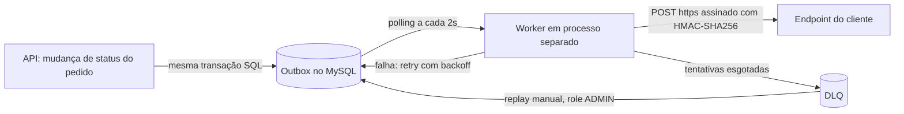

# RFC: Sistema de Webhooks de Notificação de Pedidos

| Campo | Valor |
|---|---|
| Autor | Larissa (Tech Lead), que ficou de abrir o doc de design da feature ([09:50] Larissa) |
| Status | Em revisão |
| Data | 2026-11-17 |
| Revisores | Larissa (Tech Lead), Marcos (Product Manager), Bruno (Engenheiro Pleno, time de Pedidos), Diego (Engenheiro Sênior, time de Plataforma), Sofia (Engenheira de Segurança) |
| Documentos relacionados | [PRD](./PRD.md), [FDD](./FDD.md), [ADRs](./adrs/), [Tracker](./TRACKER.md) |

## 1. Resumo executivo (TL;DR)

Propomos que o OMS passe a notificar clientes B2B por webhooks de saída sempre que o status de um pedido mudar. O evento é gravado em uma outbox no MySQL, na mesma transação da mudança de status, e um worker separado entrega por HTTP com assinatura HMAC-SHA256, retry com backoff e DLQ. A garantia é at-least-once, com deduplicação pelo cliente via `X-Event-Id`. Ficam em aberto o rate limiting de saída, a estratégia para escalar o worker sem perder a ordem dos eventos e o endurecimento das permissões do CRUD de configuração.

## 2. Contexto e problema

Três clientes B2B (Atlas Comercial, MaxDistribuição e Nova Cargo) pediram formalmente para ser notificados quando o status dos pedidos deles muda. Hoje eles consultam `GET /orders` de tempos em tempos, o que deixa a integração lenta e cara. A Atlas sinalizou que pode migrar para um concorrente se isso não for entregue até o fim do trimestre ([09:00] Marcos). Para os clientes, qualquer atraso abaixo de 10 segundos já conta como tempo real ([09:02] Marcos).

O OMS não tem hoje nenhum mecanismo de evento, fila ou webhook. A mudança de status vive em `OrderService.changeStatus` (`src/modules/orders/order.service.ts`), dentro de uma transação que valida a transição, movimenta estoque, atualiza o pedido e grava o histórico. O time considera essa transação já pesada ([09:04] Bruno), e qualquer solução precisa respeitar isso.

O escopo é só de saída: o OMS envia para os clientes, e eles não enviam nada de volta ([09:02] Marcos, [09:03] Sofia).

## 3. Proposta técnica

A proposta tem seis blocos, cada um registrado em um ADR:

1. **Outbox no MySQL.** O evento é inserido em uma tabela de outbox dentro da mesma transação que muda o status. Se a transação confirmar, o evento existe. Se sofrer rollback, o evento some junto. Ver [ADR-001](./adrs/ADR-001-outbox-no-mysql.md).
2. **Worker separado em polling.** Um processo próprio, fora da API, lê os eventos pendentes a cada 2 segundos e faz as chamadas HTTP. Nesta fase roda um único worker. Ver [ADR-002](./adrs/ADR-002-worker-separado-com-polling.md).
3. **Retry com backoff e DLQ.** Falhas de entrega são retentadas com intervalos crescentes. Esgotadas as tentativas, o evento vai para uma DLQ em tabela separada, com replay manual por endpoint administrativo. Ver [ADR-003](./adrs/ADR-003-retry-com-backoff-e-dlq.md).
4. **At-least-once com `X-Event-Id`.** O mesmo evento pode chegar mais de uma vez. Cada evento leva um identificador único para o cliente deduplicar. Ver [ADR-004](./adrs/ADR-004-at-least-once-com-x-event-id.md).
5. **HMAC-SHA256 com secret por endpoint.** Cada envio é assinado com a secret do endpoint de destino, que pode ser rotacionada com 24 horas de convivência entre a antiga e a nova. Só são aceitas URLs `https`. Ver [ADR-005](./adrs/ADR-005-hmac-sha256-secret-por-endpoint.md).
6. **Reuso dos padrões do projeto.** O webhook entra como um módulo igual aos demais, com os mesmos padrões de erro, log, validação e autorização. Ver [ADR-006](./adrs/ADR-006-reuso-dos-padroes-do-projeto.md).

Como apoio, o payload é gravado como snapshot no momento da inserção, para refletir o pedido como estava quando o status mudou. Ver [ADR-007](./adrs/ADR-007-payload-snapshot-na-insercao.md).

Do lado do cliente, a configuração é feita por API: cadastro, edição, remoção e listagem de endpoints, escolha dos status de interesse, rotação de secret e consulta ao histórico de entregas. Os contratos e fluxos detalhados estão no [FDD](./FDD.md).

## 4. Alternativas consideradas

### RFC-ALT-01: Disparo síncrono dentro do service de pedidos
- Descrição: fazer a chamada HTTP ao cliente dentro de `changeStatus`, no momento da mudança de status ([09:03] Larissa).
- Trade-off que motivou o descarte: é a opção mais simples, mas coloca uma chamada externa no meio de uma transação já pesada. Um cliente lento travaria mudanças de status de outros pedidos, e um cliente fora do ar forçaria uma escolha inaceitável entre perder o evento e dar rollback no status ([09:04] Bruno). "Síncrono está fora de questão" ([09:06] Diego).

### RFC-ALT-02: Redis Streams ou broker equivalente
- Descrição: publicar os eventos em uma infraestrutura dedicada de mensageria ([09:07] Larissa).
- Trade-off que motivou o descarte: traria um mecanismo próprio de consumo, mas exigiria subir e operar mais infraestrutura. Para um time pequeno, subir Redis Cluster para isso é overengineering, e a outbox no MySQL existente resolve ([09:07] Diego).

### RFC-ALT-03: Trigger do banco em vez de polling
- Descrição: usar trigger do MySQL para tornar o worker mais reativo ([09:09] Bruno).
- Trade-off que motivou o descarte: reduziria a latência, mas o MySQL não tem listener nativo como o NOTIFY/LISTEN do Postgres. A trigger só executa SQL, e avisar um processo externo exigiria improviso. O polling de 2 segundos já atende o limite de 10 segundos ([09:09] Diego).

### RFC-ALT-04: Garantia exactly-once
- Descrição: garantir que cada evento chegue ao cliente exatamente uma vez.
- Trade-off que motivou o descarte: eliminaria duplicatas, mas exige coordenação dos dois lados e fica muito mais complexo. At-least-once com `event_id` segue o padrão de mercado e resolve 99% dos casos ([09:25] Diego).

Alternativas de menor porte (retry indefinido, 3 tentativas, secret global, renderizar o payload no envio) estão nos ADRs correspondentes.

## 5. Questões em aberto

### RFC-OQ-01: Rate limiting de envio para o cliente
- Por que está em aberto: se um cliente tiver 50 pedidos mudando de status em um minuto, ele recebe 50 chamadas ([09:38] Diego). A reunião decidiu não incluir no escopo, observar e implementar se virar problema ([09:39] Diego, [09:39] Larissa).
- Impacto de não decidir agora: clientes com alto volume podem receber rajadas. Sem métricas de volume por endpoint, não haverá dado para decidir depois.

### RFC-OQ-02: Escala do worker e garantia de ordem
- Por que está em aberto: a ordem dos eventos vale por `order_id` e só enquanto houver um único worker ([09:13] Larissa). Particionar por `order_id` ou usar lock pessimista foram citados como caminhos, mas tratados como problema do futuro ([09:13] Diego).
- Impacto de não decidir agora: a vazão fica limitada a um worker. Qualquer tentativa de escalar horizontalmente antes dessa decisão quebra a ordem por pedido.

### RFC-OQ-03: Permissões do CRUD de configuração
- Por que está em aberto: por enquanto, qualquer role autenticada pode gerenciar a configuração de webhooks. A Segurança indicou que isso pode ser endurecido mais à frente ([09:36] Marcos, [09:37] Sofia).
- Impacto de não decidir agora: qualquer usuário autenticado pode cadastrar, editar ou remover endpoints de qualquer cliente.

### RFC-OQ-04: Arquivamento das linhas entregues
- Por que está em aberto: foi mencionado arquivar linhas entregues depois de "30 dias ou assim", fora do escopo desta feature ([09:08] Diego). Não há prazo nem responsável.
- Impacto de não decidir agora: a outbox cresce sem limite, o que pode afetar o desempenho do polling com o tempo ([09:07] Bruno).

### RFC-OQ-05: Contagem exata das tentativas
- Por que está em aberto: a reunião fechou "5 tentativas, backoff 1m/5m/30m/2h/12h" ([09:17] Larissa), e a conta de quase 15 horas foi feita "entre primeira falha e última tentativa" ([09:17] Diego). Os cinco intervalos somados dão esse total, o que sugere um envio inicial mais cinco retentativas. A frase "total 5 tentativas" do resumo ([09:48] Larissa) permite ler como cinco envios ao todo. Este ponto foi identificado na redação dos documentos, não na reunião.
- Impacto de não decidir agora: a implementação pode divergir em um envio e em 12 horas de janela. O FDD adota a primeira leitura como suposição, marcada para confirmação.

## 6. Impacto e riscos

**Impacto no sistema existente**
- A transação de `OrderService.changeStatus` ganha uma escrita na outbox. É a única alteração em código crítico já existente ([09:40] Bruno).
- O projeto ganha um módulo novo, novas tabelas no MySQL e um segundo processo (o worker), com deploy e monitoramento próprios.
- Os endpoints atuais de pedidos não mudam de contrato.

**Riscos arquiteturais**

| ID | Risco | Mitigação resumida |
|---|---|---|
| RFC-RISK-01 | Falha na inserção da outbox derruba a mudança de status, já que tudo roda na mesma transação ([09:40] Bruno) | Comportamento intencional para não perder evento ([09:41] Diego). Coberto por testes ponta a ponta da integração ([09:46] Larissa) |
| RFC-RISK-02 | Perda da ordem dos eventos se o worker for escalado ([09:12] Diego) | Um único worker nesta fase e limitação documentada ([09:13] Larissa). Ver RFC-OQ-02 |
| RFC-RISK-03 | Vazamento de secret do lado do cliente, como já ocorreu ([09:22] Diego) | Secret por endpoint e rotação com grace period de 24 horas ([09:22] Sofia) |
| RFC-RISK-04 | Defeito em HMAC ou geração de secret chegar a produção | Revisão de segurança de pelo menos dois dias úteis antes do deploy ([09:46] Sofia) |
| RFC-RISK-05 | Cliente fora do ar por mais tempo que a janela de retry | DLQ com replay manual ([09:18] Diego) |

O prazo estimado é de três sprints, com a revisão de segurança incluída no fim ([09:47] Larissa).

## 7. Decisões relacionadas

- [ADR-001: Padrão Outbox no MySQL](./adrs/ADR-001-outbox-no-mysql.md)
- [ADR-002: Worker em processo separado com polling de 2 segundos](./adrs/ADR-002-worker-separado-com-polling.md)
- [ADR-003: Retry com backoff exponencial e DLQ em tabela separada](./adrs/ADR-003-retry-com-backoff-e-dlq.md)
- [ADR-004: Garantia at-least-once com X-Event-Id](./adrs/ADR-004-at-least-once-com-x-event-id.md)
- [ADR-005: HMAC-SHA256 com secret por endpoint e rotação](./adrs/ADR-005-hmac-sha256-secret-por-endpoint.md)
- [ADR-006: Reuso dos padrões existentes do projeto](./adrs/ADR-006-reuso-dos-padroes-do-projeto.md)
- [ADR-007: Payload gravado como snapshot na inserção](./adrs/ADR-007-payload-snapshot-na-insercao.md)
